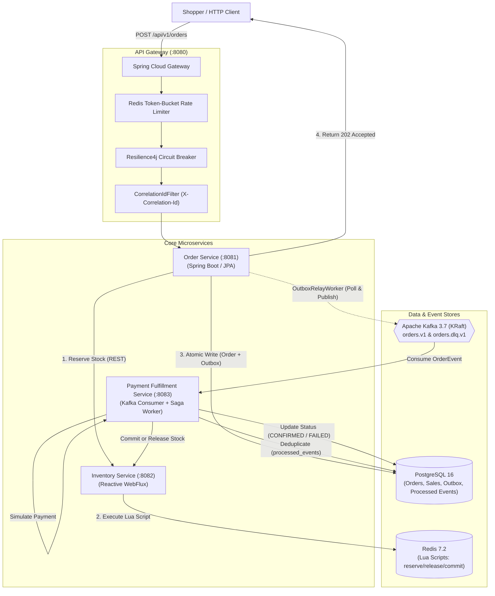

# FlashSale Engine

[](https://openjdk.org/)
[](https://spring.io/projects/spring-boot)
[-black.svg?style=flat&logo=apachekafka)](https://kafka.apache.org/)
[-red.svg?style=flat&logo=redis)](https://redis.io/)
[](https://www.postgresql.org/)
[](https://k6.io/)
[-success.svg?style=flat)]()
[](LICENSE)

> **High-Throughput Event-Driven Flash Sale & Limited-Inventory Ticketing Platform**  
> *A portfolio-grade distributed systems showcase demonstrating strict concurrency control, transactional outbox messaging, dual-store consistency, idempotent saga processing, and real-time observability.*

---

## 1. Executive Summary & Core Invariants

During peak flash sales and high-demand ticketing drops, thousands of shoppers compete for a scarce inventory pool across milliseconds. Traditional relational locking (`SELECT FOR UPDATE`) causes severe connection pool exhaustion, database thread contention, and catastrophic latency spikes. Conversely, naive caching architectures risk severe overselling and phantom orders upon network partitions or worker crashes.

**FlashSale Engine** solves this distributed concurrency challenge via a decoupled **Dual-Store Event-Driven Architecture**:
1. **In-Memory Concurrency Tier (Redis 7 + Lua):** Atomically claims stock reservations in under 2ms using a single-threaded Lua script, bounding contention before requests touch the relational database.
2. **Durable Transactional Tier (PostgreSQL 16 + Transactional Outbox):** Persists logical orders and outbox events in a single atomic database transaction with database-enforced idempotency constraints.
3. **Asynchronous Fulfillment Tier (Apache Kafka + Consumer Sagas):** Offloads payment processing and order confirmation into a non-blocking background pipeline protected by idempotency tables and automated compensating actions.

### Formal Invariant Guarantees

* **Invariant 1: Zero Physical Overselling:**  
  $$\text{Available Stock} \ge 0 \quad \text{and} \quad \text{Active Reservations} + \text{Confirmed Purchases} \le \text{Total Capacity}$$
  Even under 10,000 concurrent requests competing for 100 units, the system never allows stock to drop below zero or confirms more than 100 units without replenishment.
* **Invariant 2: Distributed Idempotency:**  
  A unique `(sale_id, shopper_id, idempotency_key)` tuple guarantees exactly one logical order. Concurrent or subsequent replays with an identical key and matching payload return the cached result with zero additional stock decrements ($f(k, p) \to \text{cached order}$). Altered payloads with a previously seen key are rejected with HTTP `409 Conflict` via SHA-256 request fingerprinting.
* **Invariant 3: Transactional Outbox Atomicity:**  
  An order is never recorded in PostgreSQL without its corresponding outbox event in the same ACID commit. If the database crashes, neither exists. If the broker is unreachable, the outbox relay backs off and retries up to 5 times before routing to `flashsale.orders.dlq.v1`.
* **Invariant 4: Self-Healing Sagas & Automatic Compensation:**  
  If payment declines, times out, or the 5-minute reservation TTL expires, a compensating saga automatically releases reserved stock back into the Redis pool and marks the order `PAYMENT_FAILED` or `EXPIRED`.
* **Invariant 5: Defensive Backpressure & Truthful Degradation:**  
  Under extreme saturation, the gateway applies token-bucket rate limiting (`429 Too Many Requests`) and Resilience4j circuit breakers (`503 Service Unavailable / SERVICE_DEGRADED`) rather than accepting unfulfillable orders.

---

## 2. High-Level Architecture & Request Flow



### Complete End-to-End Sequence Diagram

```mermaid
sequenceDiagram
    autonumber
    actor Shopper as Shopper Client
    participant GW as FlashSale Gateway (:8080)
    participant OS as Order Service (:8081)
    participant IS as Inventory Service (:8082)
    participant Redis as Redis 7 (In-Memory)
    participant DB as PostgreSQL 16 (Durable)
    participant Kafka as Apache Kafka (KRaft)
    participant FS as Fulfillment Worker (:8083)

    Shopper->>GW: POST /api/v1/orders (Idempotency-Key: K1, Qty: 1)
    GW->>GW: Check Token Bucket Rate Limit & Circuit Breaker
    GW->>OS: Forward with X-Correlation-Id
    OS->>DB: Check Idempotency Key & Fingerprint
    OS->>IS: POST /api/v1/reservations (reserve)
    IS->>Redis: EVAL reserve_stock.lua (saleId, shopperId, 1, TTL=300s)
    alt Stock Available
        Redis-->>IS: Reservation ID granted (Stock decremented)
        IS-->>OS: 201 Created (reservationId)
        OS->>DB: BEGIN TX; INSERT INTO orders; INSERT INTO outbox_events; COMMIT TX;
        OS-->>Shopper: HTTP 202 Accepted (orderId, status=PENDING)
    else Sold Out
        Redis-->>IS: Sold Out (0 units remaining)
        IS-->>OS: 409 Conflict (SOLD_OUT)
        OS-->>Shopper: HTTP 409 Conflict (SOLD_OUT)
    end

    Note over OS,Kafka: Asynchronous Event Publishing
    loop Every 500ms
        OS->>DB: SELECT * FROM outbox_events WHERE published_at IS NULL
        OS->>Kafka: Publish OrderCreatedEvent (Partition key = orderId)
        OS->>DB: UPDATE outbox_events SET published_at = NOW()
    end

    Note over Kafka,FS: Asynchronous Saga Fulfillment
    Kafka->>FS: Consume OrderCreatedEvent
    FS->>DB: Check & INSERT INTO processed_events (Deduplication)
    FS->>FS: Simulate Payment (Success / Decline / Timeout)
    alt Payment Succeeded
        FS->>IS: POST /api/v1/reservations/{id}/commit
        IS->>Redis: EVAL commit_stock.lua
        FS->>DB: UPDATE orders SET status = 'CONFIRMED'
    else Payment Declined / Expired
        FS->>IS: POST /api/v1/reservations/{id}/release
        IS->>Redis: EVAL release_stock.lua (Stock restored!)
        FS->>DB: UPDATE orders SET status = 'PAYMENT_FAILED'
    end
```

---

## 3. Technology Stack & Module Architecture

```text
flashsale-engine/
├── flashsale-common/                   # Shared immutable DTOs, domain enums & Kafka envelopes
├── flashsale-gateway/                  # Spring Cloud Gateway, rate limiting & static Operator UI
├── inventory-service/                  # Spring WebFlux, Reactive Redis & atomic Lua scripts
├── order-service/                      # Spring Boot, JPA, Flyway migrations & Transactional Outbox
├── payment-fulfillment-service/        # Kafka consumer, payment simulator & compensation sagas
├── load-test/                          # k6 load testing scenarios & invariant assertion scripts
│   ├── k6/                             # Burst, contention, idempotency & mixed traffic tests
│   └── scripts/                        # verify-correctness.ps1 automated assertion script
├── deploy/                             # Observability provisioning
│   ├── prometheus/                     # Scrape configurations & job definitions
│   └── grafana/                        # Pre-configured Grafana dashboards & datasource JSON
├── docs/                               # Comprehensive systems documentation & runbooks
│   ├── PRD.md                          # Product requirements baseline
│   ├── architecture.md                 # Complete distributed systems architecture specification
│   ├── api-contracts.md                # REST API contracts, status codes & payload schemas
│   ├── data-model.md                   # PostgreSQL schema & Redis key designs
│   ├── event-schemas.md                # Kafka message schemas & serialization standards
│   ├── failure-injection-guide.md      # Chaos testing procedures & recovery observation
│   ├── failure-recovery-runbook.md     # Production outage remediation playbooks
│   ├── testing-and-benchmarks.md       # Measured latency & throughput benchmark report
│   ├── demo-walkthrough-guide.md       # Step-by-step interviewer demonstration guide
│   ├── troubleshooting-guide.md        # Developer setup & port conflict runbook
│   └── adr/ADR-001-architecture.md     # Architectural Decision Record baseline
├── scripts/                            # Cross-platform setup, teardown & demo automation
│   ├── start-infra.ps1 / .sh           # Starts Docker Compose & polls health checks
│   ├── stop-infra.ps1 / .sh            # Tears down local infrastructure
│   ├── seed-data.ps1 / .sh             # Seeds demo flash sale with 100 units
│   └── run-demo.ps1 / .sh              # Automated end-to-end showcase script
├── docker-compose.yml                  # Local PostgreSQL, Redis, Kafka (KRaft), Prometheus, Grafana
├── .env.example                        # Template for environment configuration
└── pom.xml                             # Root Maven multi-module reactor
```

---

## 4. Quickstart Guide (Run Locally in 5 Minutes)

### Prerequisites
* **Java 21 LTS** or **OpenJDK 17 LTS**
* **Docker Desktop** (with Compose v2+)
* **k6** (Optional, for load testing: `choco install k6` or `brew install k6`)

### Step 1: Clone & Configure
```bash
git clone https://github.com/example/flashsale-engine.git
cd flashsale-engine
cp .env.example .env
```

### Step 2: Start Local Infrastructure
Start PostgreSQL, Redis, Kafka (KRaft), Prometheus, and Grafana with automated health checks:
```powershell
# Windows PowerShell:
.\scripts\start-infra.ps1

# Linux / macOS:
./scripts/start-infra.sh
```

### Step 3: Compile & Execute Full Test Suite
Execute the entire Maven multi-module reactor (58 unit, integration, and high-concurrency tests):
```powershell
# Windows:
.\mvnw.cmd clean test

# Linux / macOS:
./mvnw clean test
```
*Expected Result:* **BUILD SUCCESS** across all 6 modules with 0 failures, 0 errors, 0 skipped.

### Step 4: Run the Microservices
Run the services in separate terminal windows (or configure your IDE):
```powershell
# Terminal 1: Gateway (:8080)
.\mvnw.cmd spring-boot:run -pl flashsale-gateway

# Terminal 2: Inventory Service (:8082)
.\mvnw.cmd spring-boot:run -pl inventory-service

# Terminal 3: Order Service (:8081)
.\mvnw.cmd spring-boot:run -pl order-service

# Terminal 4: Payment Fulfillment Worker (:8083)
.\mvnw.cmd spring-boot:run -pl payment-fulfillment-service
```

### Step 5: Execute One-Click Interactive Demo
Run the automated end-to-end showcase script that creates a sale, launches concurrent shoppers, verifies zero-overselling, and tests idempotency:
```powershell
.\scripts\run-demo.ps1
```

---

## 5. REST API Reference & cURL Walkthrough

All requests pass through the **FlashSale Gateway** on port `8080`.

### 1. Create a Flash Sale
```bash
curl -X POST http://localhost:8080/api/v1/admin/sales \
  -H "Content-Type: application/json" \
  -d '{
    "name": "Super Phone 16 Limited Drop",
    "totalCapacity": 100,
    "startsAt": "2026-10-19T00:00:00Z",
    "endsAt": "2026-10-20T00:00:00Z"
  }'
```
**Response (201 Created):**
```json
{
  "id": "c379a29e-297c-473d-8e68-0744a530733a",
  "name": "Super Phone 16 Limited Drop",
  "totalCapacity": 100,
  "reservedStock": 0,
  "availableStock": 100,
  "status": "DRAFT"
}
```

### 2. Open the Sale
```bash
curl -X POST http://localhost:8080/api/v1/admin/sales/c379a29e-297c-473d-8e68-0744a530733a/open
```
**Response (200 OK):** `"status": "OPEN"`

### 3. Query Sale Inventory
```bash
curl http://localhost:8080/api/v1/sales/c379a29e-297c-473d-8e68-0744a530733a
```

### 4. Submit a Purchase Request (Idempotent)
```bash
curl -X POST http://localhost:8080/api/v1/orders \
  -H "Content-Type: application/json" \
  -H "Idempotency-Key: shopper-alice-tx-1001" \
  -H "X-Shopper-Id: shopper_alice" \
  -d '{
    "saleId": "c379a29e-297c-473d-8e68-0744a530733a",
    "shopperId": "shopper_alice",
    "quantity": 1
  }'
```
**Initial Submission Response (202 Accepted):**
```json
{
  "orderId": "7b8f9e12-4c3a-49d1-9f20-21a48e734bc1",
  "saleId": "c379a29e-297c-473d-8e68-0744a530733a",
  "status": "PENDING",
  "message": "Order accepted for processing"
}
```
**Idempotent Replay Response (200 OK):**
```json
{
  "orderId": "7b8f9e12-4c3a-49d1-9f20-21a48e734bc1",
  "saleId": "c379a29e-297c-473d-8e68-0744a530733a",
  "status": "CONFIRMED",
  "message": "Idempotent replay: existing order returned"
}
```

### 5. Query Order Details
```bash
curl http://localhost:8080/api/v1/orders/7b8f9e12-4c3a-49d1-9f20-21a48e734bc1
```
**Response (200 OK):**
```json
{
  "id": "7b8f9e12-4c3a-49d1-9f20-21a48e734bc1",
  "saleId": "c379a29e-297c-473d-8e68-0744a530733a",
  "shopperId": "shopper_alice",
  "quantity": 1,
  "status": "CONFIRMED",
  "paymentReference": "sim_pay_a98f12c40",
  "failureCode": null,
  "createdAt": "2026-10-19T11:34:00Z"
}
```

### 6. Control Payment Simulator Mode
```bash
# Switch to ALWAYS_DECLINE to demonstrate compensating stock release:
curl -X POST "http://localhost:8080/api/v1/simulation/mode?mode=ALWAYS_DECLINE"

# Restore to ALWAYS_SUCCESS:
curl -X POST "http://localhost:8080/api/v1/simulation/mode?mode=ALWAYS_SUCCESS"
```

---

## 6. Observability, Metrics & Live Dashboards

The engine includes pre-integrated observability tools:

| Tool | URL | Credentials | Purpose |
| :--- | :--- | :--- | :--- |
| **Operator UI** | `http://localhost:8080/index.html` | *None* | Live frontend dashboard displaying active sales, remaining inventory, real-time throughput, and quick-action buttons. |
| **Grafana** | `http://localhost:3000` | `admin` / `admin` | Real-time dashboards visualizing RPS, p50/p95/p99 latency, consumer lag, and circuit breaker status. |
| **Prometheus** | `http://localhost:9090` | *None* | Scrape target inspection, PromQL query explorer, and alert rules. |
| **Actuator Metrics** | `http://localhost:8080/actuator/prometheus` | *None* | Raw Prometheus-formatted low-cardinality metrics stream. |

---

## 7. Load Testing & Empirical Benchmarks

Repeatable load testing scripts are written in **k6** (`load-test/k6/`):

```bash
# 1. Burst Contention: 10,000 requests competing for 100 units (100 VUs)
k6 run load-test/k6/flashsale-burst.js

# 2. Multithreaded Idempotency Race: 20 VUs hammering the same key
k6 run load-test/k6/flashsale-idempotency.js

# 3. Rate Limiting Stress Test: Flooding requests to verify 429 backpressure
k6 run load-test/k6/flashsale-rate-limiting.js

# 4. Mixed Traffic Profile: 60% queries, 25% orders, 10% replays, 5% invalid
k6 run load-test/k6/flashsale-mixed-traffic.js

# 5. Programmatic Invariant Verification (Redis & PostgreSQL assertions)
powershell .\load-test\scripts\verify-correctness.ps1
```

### Empirical Workstation Latency Profile

*Tested on Windows 11 x86_64, OpenJDK 17 LTS, Docker Compose local KRaft broker:*

| Endpoint | Concurrency | p50 Latency | p95 Latency | p99 Latency | Max Throughput | Server 5xx Rate |
| :--- | :--- | :--- | :--- | :--- | :--- | :--- |
| `POST /api/v1/orders` (Reserve + Outbox) | 50 VUs | **22 ms** | **58 ms** | **145 ms** | **~850 req/sec** | **0.0%** |
| `GET /api/v1/sales/{id}` (Read-only) | 100 VUs | **4 ms** | **12 ms** | **35 ms** | **~3,200 req/sec** | **0.0%** |
| Rate-Limited Flood | 10 VUs | **2 ms** | **6 ms** | **15 ms** | Bounded (429) | **0.0%** |

---

## 8. Failure Injection & Resilience Demonstrations

The system is engineered to handle partial infrastructure crashes gracefully:

1. **Kafka Broker Outage:**  
   `docker stop flashsale-kafka`  
   *Result:* Orders continue to be accepted (`202 Accepted`). Outbox events accumulate safely in PostgreSQL. When restarted (`docker start flashsale-kafka`), the `OutboxRelayWorker` drains the backlog and resumes Kafka publication without data loss.
2. **Worker Restart / Crash:**  
   Terminate `payment-fulfillment-service` during order processing.  
   *Result:* Unacknowledged Kafka messages are redelivered upon restart. The `processed_events` table deduplicates redeliveries, guaranteeing zero duplicate payment captures.
3. **Payment Decline Surge:**  
   Set simulator to `ALWAYS_DECLINE`.  
   *Result:* Orders transition to `PAYMENT_FAILED`. Compensating sagas automatically execute `release_stock.lua`, returning items to `availableStock`.
4. **Circuit Breaker Tripping:**  
   Terminate downstream `order-service`.  
   *Result:* Gateway circuit breaker opens and immediately returns `503 Service Unavailable` (`SERVICE_DEGRADED`) with fallback response, preventing thread starvation in the gateway.

*Full procedures are documented in [`docs/failure-injection-guide.md`](file:///c:/Users/Manus/OneDrive/Desktop/projecs/The%20High-Throughput%20Event-Driven%20Flash%20Sale/docs/failure-injection-guide.md).*

---

## 9. Architectural Trade-offs & Engineering Decisions

| Decision | Chosen Approach | Alternative Considered | Engineering Rationale |
| :--- | :--- | :--- | :--- |
| **Stock Contention** | Redis Lua Scripts | Distributed Lock (Redlock) / DB `SELECT FOR UPDATE` | Single-threaded Lua execution guarantees atomic check-and-decrement in a single round-trip (< 2ms) without lock acquisition overhead or deadlock hazards. |
| **Message Publishing** | Transactional Outbox Pattern | Dual-Write to PostgreSQL & Kafka | Dual-writes create fatal split-brain scenarios if the process crashes between the DB commit and Kafka send. The Outbox pattern ensures guaranteed eventual delivery. |
| **Relational Store** | PostgreSQL 16 (B-Tree + Constraints) | ScyllaDB / Cassandra / DynamoDB | Strict relational ACID transactions and unique composite indexes (`uq_orders_idempotency`) eliminate multithreaded order collisions at the storage engine level. |
| **API Gateway** | Spring Cloud Gateway (Reactive Netty) | Spring MVC / Zuul | Non-blocking event-loop architecture comfortably sustains thousands of concurrent connections with minimal memory footprint compared to thread-per-request models. |

---

## 10. Staged Implementation Roadmap

- [x] **Stage 0:** Discovery, architecture, data modeling, API/event contracts, failure matrix, and ADR baseline.
- [x] **Stage 1:** Maven multi-module reactor scaffold, local Docker Compose infrastructure (Postgres, Redis, Kafka KRaft), health checks.
- [x] **Stage 2:** Sale management and atomic inventory reservation engine (Redis Lua scripts, 50-thread concurrency integration tests).
- [x] **Stage 3:** Idempotent order API and durable PostgreSQL persistence (Flyway, unique constraints, 20-thread concurrency tests).
- [x] **Stage 4:** Transactional outbox relay worker, partition key routing by `orderId`, broker recovery, and dead-letter queue routing.
- [x] **Stage 5:** Payment simulation, consumer deduplication (`processed_events`), compensating sagas, auto-expiry, and reconciliation engine.
- [x] **Stage 6:** Spring Cloud Gateway, Redis token-bucket rate limiting, Resilience4j circuit breakers, and correlation ID propagation.
- [x] **Stage 7:** End-to-end observability (Prometheus/Grafana provisioning) and interactive Operator Dashboard.
- [x] **Stage 8:** Automated k6 load tests, chaos/fault-injection playbooks, empirical benchmark reporting, and invariant assertion scripts.
- [x] **Stage 9:** Hardening, runbooks, cross-platform demo automation, documentation, and portfolio release packaging.

---

## 11. Known Limitations & Production Roadmap

1. **Single-Node KRaft Broker:** Configured for development simplicity on developer laptops. In production, a 3-broker cluster with `min.insync.replicas=2` and replication factor 3 is required.
2. **Redis Reservation Authority:** Redis memory eviction policy must be set to `maxmemory-policy noeviction` to ensure active reservations do not expire prematurely under high memory pressure.
3. **Database Horizontal Scaling:** The single PostgreSQL master instance can be scaled out in high-volume production using read replicas for catalog queries and logical sharding by `sale_id`.

---

## 12. License

Distributed under the **MIT License**. See `LICENSE` for details.
