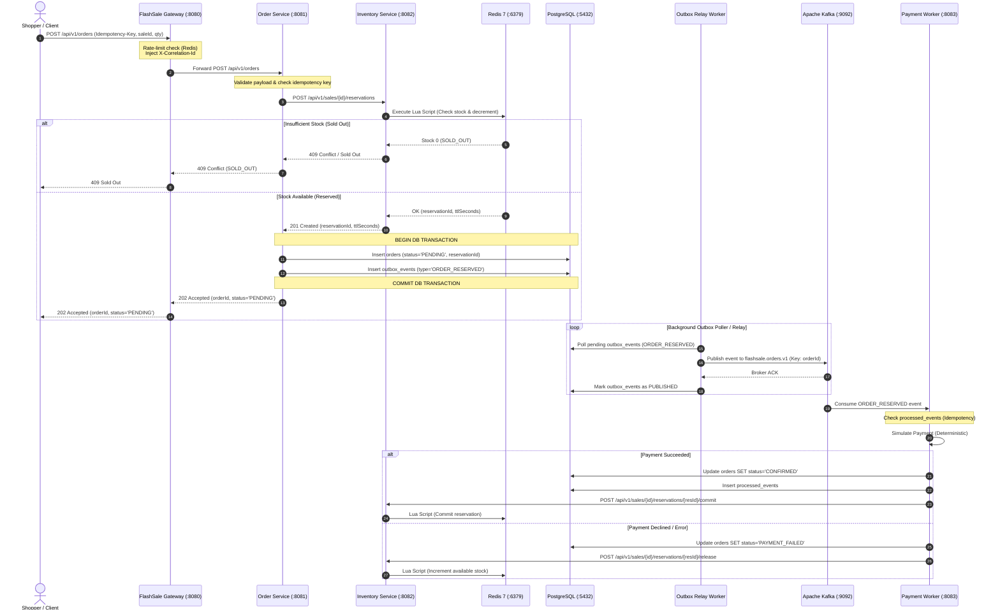
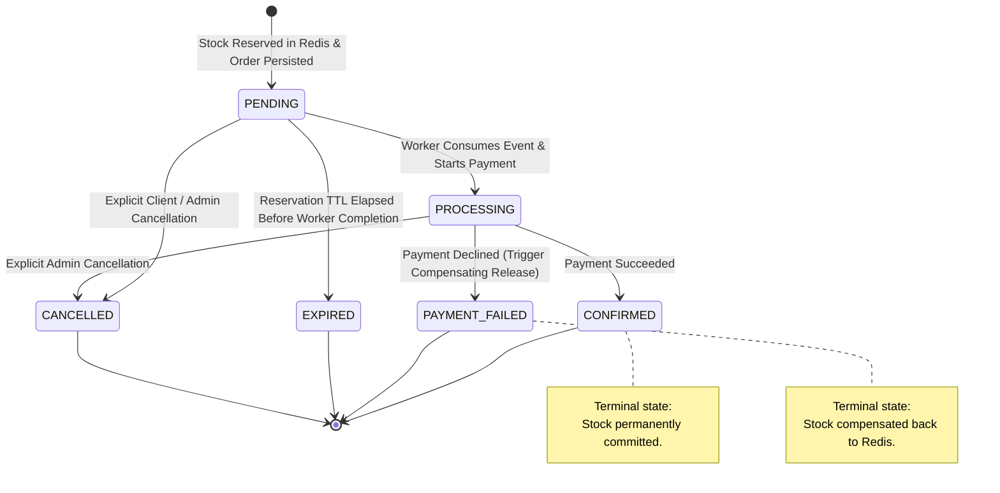
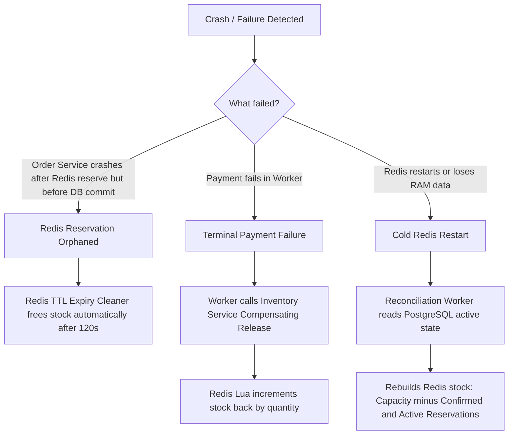

# FlashSale Engine --- System Architecture Specification

## 1. System Context & Overview

FlashSale Engine is a distributed, event-driven commerce platform built to handle severe traffic spikes during flash sales. The system addresses the classic "overselling" problem under high concurrency while maintaining high availability, low p99 latency, and durable data integrity.

### 1.1 Architectural Goals
* **P99 Latency & Concurrency:** Process stock checks and reservations in single-digit milliseconds via in-memory atomic operations.
* **Durability & Strong Constraints:** Ensure financial and order records are guaranteed by ACID transactions in PostgreSQL.
* **Fault Isolation:** Isolate asynchronous processing (payment simulation, fulfillment) so broker or worker downtime does not block synchronous reservation acceptance.
* **Zero Overselling:** Strictly guarantee that active reservations plus confirmed orders never exceed available stock.

---

## 2. Logical Components & Network Topology

```
                                  [ Internet / Clients ]
                                             │
                                             ▼
                             ┌───────────────────────────────┐
                             │    FlashSale Gateway          │
                             │    Port: 8080                 │
                             │    (Spring Cloud Gateway)     │
                             └───────────────┬───────────────┘
                                             │
                      ┌──────────────────────┴──────────────────────┐
                      ▼                                             ▼
       ┌──────────────────────────────┐              ┌──────────────────────────────┐
       │   Order Service              │              │   Inventory Service          │
       │   Port: 8081                 │              │   Port: 8082                 │
       │   (Spring Boot MVC + JPA)    │              │   (Spring WebFlux + Netty)   │
       └──────┬───────────────┬───────┘              └──────────────┬───────────────┘
              │               │                                     │
      (Outbox Relay)   (Durable Orders)                    (Atomic Lua Script)
              │               │                                     │
              ▼               ▼                                     ▼
       ┌─────────────┐ ┌──────────────┐                      ┌──────────────┐
       │ Apache Kafka│ │  PostgreSQL  │                      │   Redis 7    │
       │ Port: 9092  │ │  Port: 5432  │                      │   Port: 6379 │
       └──────┬──────┘ └──────────────┘                      └──────────────┘
              │
              ▼
       ┌──────────────────────────────┐
       │ Payment & Fulfillment Worker │
       │ Port: 8083                   │
       │ (Spring Boot Kafka Consumer) │
       └──────────────────────────────┘
```

### 2.1 Service Specifications

| Service / Component | Technology Stack | Port | Responsibilities |
| :--- | :--- | :--- | :--- |
| **FlashSale Gateway** | Spring Cloud Gateway (Netty) | `8080` | Public reverse proxy, Redis token-bucket rate limiting, request validation, header injection (`X-Correlation-Id`). |
| **Order Service** | Spring Boot 3.3 (Tomcat / Virtual Threads or Bounded Pool) | `8081` | Idempotency validation, purchase workflow orchestration, PostgreSQL ACID order persistence, Transactional Outbox publishing. |
| **Inventory Service** | Spring Boot 3.3 (WebFlux / Netty) | `8082` | Sale configuration, atomic Redis Lua stock reservation and release, reservation TTL management. |
| **Payment Worker** | Spring Boot 3.3 | `8083` | Kafka consumer group, simulated payment execution, idempotent database order transition, compensation event triggers. |
| **Redis** | Redis 7.2 (Alpine) | `6379` | In-memory atomic stock counters, reservation ID tracking, token bucket rate limiter counters. |
| **PostgreSQL** | PostgreSQL 16 (Debian) | `5432` | Durable persistence for sales, orders, reservations, outbox events, and consumer deduplication. |
| **Apache Kafka** | Kafka 3.7+ (KRaft mode) | `9092` | Durable event streaming backbone. Topics: `flashsale.orders.v1`, `flashsale.orders.dlq.v1`. |
| **Prometheus** | Prometheus v2.51 | `9090` | Time-series scraper pulling Actuator metrics from all services every 5 seconds. |
| **Grafana** | Grafana v10.4 | `3000` | Operational visualization dashboards for throughput, p99 latency, consumer lag, and stock levels. |
| **Operator Dashboard**| React / Vite or Static HTML/JS | `8085` | Operator control panel for sale setup, live metrics, order lookup, and controlled failure demos. |

---

## 3. Distributed Consistency Model: Redis + PostgreSQL + Kafka

A fundamental challenge in high-throughput systems is coordinating state across heterogeneous datastores (Redis, PostgreSQL, and Kafka) without distributed two-phase commit (2PC/XA), which is notoriously brittle and high-latency.

### 3.1 Dual-Store Strategy: Authority Separation
1. **Redis is the Fast Reservation Authority:**
   * High write-throughput: Redis handles the hot-path stock contention in RAM using single-threaded Lua script atomicity.
   * Decrements happen in microseconds.
   * If Redis returns `SOLD_OUT`, the request is immediately rejected without hitting PostgreSQL or Kafka.
2. **PostgreSQL is the Durable Order Authority:**
   * PostgreSQL guarantees that accepted orders, payment receipts, audit logs, and state transitions cannot be lost.
   * A reservation token granted by Redis is persisted alongside the order in PostgreSQL.
3. **Kafka is the Asynchronous Event Backbone:**
   * Decouples the synchronous HTTP request cycle from downstream payment verification and ticket fulfillment.

---

## 4. End-to-End Request Flow

The following sequence details an incoming purchase request through successful asynchronous fulfillment:



---

## 5. Order Lifecycle Finite State Machine

The order lifecycle follows a strictly enforced finite state machine. Unrecognized or illegal transitions are rejected at the service layer and audited.



### State Transition Validation Rules:
* `PENDING -> PROCESSING`: Valid only once an outbox event is dequeued by the worker.
* `PROCESSING -> CONFIRMED`: Valid only upon successful simulated payment. Marks reservation as committed.
* `PROCESSING -> PAYMENT_FAILED`: Valid upon payment decline or exhausted retry limit. Triggers stock release saga.
* `PENDING -> EXPIRED`: Valid if reservation TTL expires before worker commits payment.
* `* -> CANCELLED`: Only allowed prior to `CONFIRMED`.

---

## 6. Transactional Outbox Pattern & Kafka Relay

To eliminate the "dual-write" failure window between PostgreSQL and Kafka, the system utilizes the **Transactional Outbox Pattern**:

```mermaid
flowchart LR
    subgraph OrderService["Order Service (Single PostgreSQL Transaction)"]
        A[Create Order Entity: PENDING] --> B[Create Outbox Event Entity]
        B --> C[(PostgreSQL DB)]
    end

    subgraph Relay["Outbox Relay Worker"]
        C -->|Poll unprocessed events| D[Read Batch (LIMIT 100)]
        D -->|Publish Message| E[Kafka: flashsale.orders.v1]
        E -->|ACK received| F[Update outbox_events: published_at=NOW]
    end

    subgraph DeadLetter["DLQ Handler"]
        D -.->|Exhausted Retries > 5| G[Kafka: flashsale.orders.dlq.v1]
    end
```

### Outbox Guarantees:
1. **At-Least-Once Delivery:** An outbox event is only marked `PUBLISHED` after Kafka returns a valid partition/offset acknowledgement.
2. **Crash Resilience:** If the relay crashes after publishing to Kafka but before updating PostgreSQL, the event is re-polled and re-sent upon restart.
3. **Consumer Idempotency:** The payment worker guards against duplicate deliveries by checking the `processed_events` table within its transaction.

---

## 7. Compensating Sagas & Reconciliation Protocol

Because reservations in Redis and order records in PostgreSQL are separate, failure scenarios must be addressed with deterministic compensating actions and reconciliation.



### 7.1 Key Reconciliation Rules
1. **Orphaned Reservations:** Every Redis reservation has a bounded TTL (default: 120 seconds). If no order claims or commits it, the key expires. A Redis key-space notification or background worker re-increments stock if needed.
2. **Payment Failure Saga:** Payment worker issues an idempotent `POST /api/v1/sales/{id}/reservations/{resId}/release` to restore stock to Redis.
3. **Reconciliation Job:** A periodic background job (running every 60 seconds) queries PostgreSQL for confirmed orders and active reservations, cross-checking them against Redis counters. Any discrepancy is logged with structured alert metrics (`flashsale.reconciliation.mismatch`).

---

## 8. Threading Model & Reactive Boundaries

* **Gateway (Spring Cloud Gateway):** Fully reactive Netty event loops. Non-blocking routing and Redis reactive rate limiting. No blocking operations allowed.
* **Inventory Service (Spring WebFlux):** Reactive Netty server using `ReactiveRedisTemplate` (Lettuce non-blocking client). Lua scripts run asynchronously on Redis event loop.
* **Order Service (Spring Boot MVC + JPA):** Runs on standard Servlet containers. Database operations use standard blocking JDBC/JPA isolated within dedicated worker thread pools with strict connection pool sizing (HikariCP, `maximum-pool-size: 30`).
* **Payment Worker:** Dedicated Kafka consumer listener containers with bounded concurrency (`concurrency: 4`).
