# FlashSale Engine — AWS Target Architecture Specification

**Status:** Target Design Specification  
**Architecture Tier:** Enterprise Cloud-Native Flash-Sale Platform  
**Target Invariant:** Zero-Overselling & Sub-Second Latency under 20,000+ RPS Burst Traffic  
**Infrastructure Provider:** Amazon Web Services (AWS)  

---

## 1. Architectural Overview & Design Philosophy

The target AWS architecture transforms the containerized FlashSale Engine into a resilient, multi-region ready, Multi-AZ cloud platform capable of absorbing extreme traffic surges. The architecture prioritizes:
1. **Edge Protection & Static Asset Offloading:** AWS WAF and Amazon CloudFront absorb volumetric attacks, bot traffic, and serve cached UI assets.
2. **Sub-Millisecond In-Memory Atomic Coordination:** Amazon ElastiCache for Redis (Multi-AZ with Auto-Failover) manages high-speed token bucket rate limiting and atomic stock reservation leases.
3. **Durable Relational Persistence with Connection Multiplexing:** Amazon Aurora PostgreSQL Multi-AZ paired with AWS RDS Proxy to eliminate connection exhaustion under horizontal pod autoscaling.
4. **Decoupled Asynchronous Streaming & Outbox:** Amazon MSK (Managed Streaming for Kafka) provides the durable event backbone fed by a Transactional Outbox Relay, completely decoupling checkout latency from payment settlement.
5. **Automated Reconciliation & Drift Repair:** Amazon EventBridge triggers scheduled sweeps to repair state drift and detect orphaned reservations.
6. **Poison Pill Isolation:** Dual-tier Dead-Letter handling via Kafka DLQ and Amazon SQS DLQ for administrative replay.

---

## 2. End-to-End AWS Target Architecture Diagram

The diagram below maps every component across the network topology and visually distinguishes:
- **Synchronous HTTP Calls** (Solid Blue)
- **Durable Database Commits** (Solid Green)
- **Asynchronous Events** (Dashed Purple)
- **Compensation & Refund Paths** (Dashed Red)

```mermaid
flowchart TD
    %% =========================================================================
    %% CLIENT & EDGE PERIMETER
    %% =========================================================================
    subgraph Edge["Perimeter & Edge Tier"]
        Shopper["Shopper Browser / Mobile App"]
        WAF["AWS WAF (Bot Control, Rate Rules, Geo-Filter)"]
        CF["Amazon CloudFront (CDN Edge Cache)"]
    end

    %% =========================================================================
    %% INGESTION & LOAD BALANCING
    %% =========================================================================
    subgraph Ingestion["Ingestion & Network Tier (Multi-AZ VPC)"]
        ALB["AWS Application Load Balancer (Multi-AZ)"]
        APIGW["Spring Cloud Gateway (ECS Fargate - 3 AZs)"]
    end

    %% =========================================================================
    %% APPLICATION CORE (ECS FARGATE)
    %% =========================================================================
    subgraph Compute["Core Compute Tier (ECS Fargate - Private Subnets)"]
        InventoryService["Inventory Service (WebFlux Reactive)"]
        OrderService["Order Service (Spring Boot)"]
        OutboxRelay["Outbox Relay Worker (Fargate / Lambda)"]
        ConsumerService["Payment & Fulfillment Service (Consumer Tasks)"]
    end

    %% =========================================================================
    %% HIGH-SPEED CACHE & IN-MEMORY STATE
    %% =========================================================================
    subgraph CacheTier["In-Memory State Tier (Multi-AZ Isolated Subnets)"]
        RedisPrimary["Amazon ElastiCache Redis (Primary AZ-a)"]
        RedisReplica1["ElastiCache Replica (AZ-b)"]
        RedisReplica2["ElastiCache Replica (AZ-c)"]
    end

    %% =========================================================================
    %% DURABLE RELATIONAL STORE
    %% =========================================================================
    subgraph DataTier["Durable Data Tier (Multi-AZ Isolated Subnets)"]
        RDSProxy["AWS RDS Proxy (Connection Multiplexer)"]
        AuroraWriter["Aurora PostgreSQL (Primary Writer AZ-a)"]
        AuroraReader["Aurora PostgreSQL (Read Replica AZ-b)"]
    end

    %% =========================================================================
    %% ASYNCHRONOUS EVENT STREAMING
    %% =========================================================================
    subgraph MessagingTier["Event Streaming Tier (Amazon MSK - Multi-AZ)"]
        MSKBroker1["MSK Broker 1 (AZ-a)"]
        MSKBroker2["MSK Broker 2 (AZ-b)"]
        MSKBroker3["MSK Broker 3 (AZ-c)"]
        OrdersTopic["Topic: flashsale.orders.v1 (12 Partitions)"]
        OrdersDLQ["Topic: flashsale.orders.dlq.v1"]
    end

    %% =========================================================================
    %% RECONCILIATION & DEAD LETTER
    %% =========================================================================
    subgraph Reliability["Reliability & Reconciliation Tier"]
        EventBridge["Amazon EventBridge (Scheduled Cron Triggers)"]
        SQSDLQ["Amazon SQS DLQ (Poison Pill Holding Queue)"]
        ExtPayment["External Payment Gateway (Stripe / Bank API)"]
    end

    %% =========================================================================
    %% OBSERVABILITY & SECURITY
    %% =========================================================================
    subgraph Observability["Governance, Secrets & Observability"]
        CloudWatch["Amazon CloudWatch (Logs, Alarms, Container Insights)"]
        SecretsMgr["AWS Secrets Manager (Auto-Rotated DB & Gateway Credentials)"]
        XRay["AWS X-Ray / ADOT (Distributed Tracing Spans)"]
    end

    %% =========================================================================
    %% FLOW ARROWS & INTERACTIONS
    %% =========================================================================

    %% 1. Ingress Flows
    Shopper -->|1. HTTPS Request| WAF
    WAF --> CF
    CF -->|Static Assets / Dashboard UI| Shopper
    CF -->|Dynamic API /api/v1/*| ALB
    ALB -->|Forward| APIGW

    %% 2. Synchronous Rate Limit & Route
    APIGW -->|2. Check Rate Limits| RedisPrimary
    APIGW -->|3a. GET /sales/*| InventoryService
    APIGW -->|3b. POST /orders| OrderService

    %% 3. Reservation & Crash-Window Safe Leases
    OrderService -->|4. Synchronous Lease Call| InventoryService
    InventoryService -->|5. Atomic Lua DECRBY & Lease Hash| RedisPrimary
    RedisPrimary -.->|Async Replication| RedisReplica1
    RedisPrimary -.->|Async Replication| RedisReplica2

    %% 4. Durable Local ACID Commit (Transactional Outbox)
    OrderService ==>|6. Commit Order + Outbox in 1 ACID Tx| RDSProxy
    RDSProxy ==> AuroraWriter
    AuroraWriter -.->|Storage Replication| AuroraReader

    %% 5. Asynchronous Outbox Relay to MSK
    OutboxRelay ==>|7. Poll Unsent Events| RDSProxy
    OutboxRelay -.->|8. Publish acks=all| OrdersTopic
    OrdersTopic --- MSKBroker1
    OrdersTopic --- MSKBroker2
    OrdersTopic --- MSKBroker3
    OutboxRelay ==>|9. Update published_at| RDSProxy

    %% 6. Asynchronous Fulfillment & Concurrency
    OrdersTopic -.->|10. Dequeue OrderReserved| ConsumerService
    ConsumerService ==>|11. Check Deduplication & Set PROCESSING| RDSProxy
    ConsumerService -->|12. Process Payment with Idempotency Key| ExtPayment

    %% 7. Success Path (Commit Stock)
    ExtPayment -->|13a. Payment Approved| ConsumerService
    ConsumerService ==>|14a. Update CONFIRMED| RDSProxy
    ConsumerService -->|15a. Commit Stock Lease Lua| InventoryService
    InventoryService -->|16a. Status COMMITTED| RedisPrimary

    %% 8. Compensation Path (Decline / Timeout / Expired Lease)
    ExtPayment -.->|13b. Decline or Timeout| ConsumerService
    ConsumerService ==x|14b. Compensating Stock Release| InventoryService
    InventoryService ==x|15b. Restore Stock INCRBY| RedisPrimary
    ConsumerService ==>|16b. Update PAYMENT_FAILED| RDSProxy
    ConsumerService -.->|17b. Refund Saga if Overdue Expiration| ExtPayment

    %% 9. Reliability, DLQ & Reconciliation
    ConsumerService -.->|Exhausted Retries| OrdersDLQ
    OrdersDLQ -.->|Mirror Poison Pills| SQSDLQ
    EventBridge -.->|Trigger Expiry Reaper Every 5s| ConsumerService
    EventBridge -.->|Trigger Drift Reconciliation Every 30s| ConsumerService

    %% 10. Security & Observability Links
    OrderService --- SecretsMgr
    InventoryService --- SecretsMgr
    ConsumerService --- SecretsMgr
    OrderService -.-> CloudWatch
    ConsumerService -.-> CloudWatch
    APIGW -.-> CloudWatch
    OrderService -.-> XRay
    ConsumerService -.-> XRay

    %% =========================================================================
    %% STYLING DIRECTIVES
    %% =========================================================================
    classDef syncHttp fill:#eff6ff,stroke:#2563eb,stroke-width:2px;
    classDef durableDb fill:#ecfdf5,stroke:#059669,stroke-width:3px;
    classDef asyncMsg fill:#f3e8ff,stroke:#7c3aed,stroke-width:2px,stroke-dasharray: 5 5;
    classDef compensate fill:#fff1f2,stroke:#e11d48,stroke-width:2px,stroke-dasharray: 4 4;
    classDef infra fill:#f8fafc,stroke:#475569,stroke-width:1px;

    class APIGW,InventoryService,OrderService,ConsumerService syncHttp;
    class RDSProxy,AuroraWriter,AuroraReader durableDb;
    class OrdersTopic,OrdersDLQ,MSKBroker1,MSKBroker2,MSKBroker3,OutboxRelay asyncMsg;
    class ExtPayment,SQSDLQ,EventBridge compensate;
    class RedisPrimary,RedisReplica1,RedisReplica2,CloudWatch,SecretsMgr,XRay infra;
```



---

## 3. Subsystem Architecture & Component Specifications

### 3.1 Edge Tier: AWS WAF & Amazon CloudFront
* **CloudFront Distribution:**
  - Terminates TLS/SSL at edge locations across 400+ PoPs worldwide.
  - Caches HTML/JS/CSS dashboard and product media assets with 24-hour TTL, completely shielding origin containers from static asset requests.
  - Passes dynamic API traffic (`/api/v1/*`) directly to the Application Load Balancer with zero caching and header forwarding (`X-Correlation-Id`, `Idempotency-Key`, `Authorization`).
* **AWS WAF v2:**
  - **AWSManagedRulesCommonRuleSet:** Defends against SQL injection, cross-site scripting (XSS), and path traversal.
  - **AWSManagedRulesBotControlRuleSet:** Identifies and blocks automated headless scrapers and ticket-scalping bots.
  - **Rate-Based Rule:** Enforces a hard cap of 1,000 requests per 5 minutes per IP address to defend against Layer 7 DDoS.

### 3.2 Ingestion & Compute Tier: ALB & ECS Fargate
* **Application Load Balancer (ALB):**
  - Provisioned across 3 Availability Zones (`us-east-1a`, `us-east-1b`, `us-east-1c`).
  - Conducts HTTP health checks on `/actuator/health/liveness` every 5 seconds.
* **ECS Fargate Tasks:**
  - Microservices run in private subnets with zero direct public internet ingress.
  - **Spring Cloud Gateway (3–10 tasks):** Netty non-blocking ingress router executing Redis token-bucket rate limiting.
  - **Inventory Service (4–16 tasks):** Spring WebFlux non-blocking reactive engine communicating directly with ElastiCache via Lettuce.
  - **Order Service (4–20 tasks):** Spring Boot MVC executing order ingestion and local PostgreSQL outbox writes.
  - **Payment & Fulfillment Service (4–24 tasks):** High-throughput Kafka consumer tasks executing payment simulation and stock settlement.
  - **Autoscaling Target Tracking:** Scales Fargate tasks dynamically when average CPU utilization > 60% or ALB Request Count Per Target > 1,500.

### 3.3 High-Performance In-Memory Tier: Amazon ElastiCache for Redis
* **Configuration:**
  - Cluster Mode Enabled, 3 shards with 1 primary node and 2 read replicas spread across 3 AZs.
  - Automatic Failover enabled with Multi-AZ detection.
  - Parameter Group: `maxmemory-policy: volatile-lru` (prevents eviction of critical stock counters).
* **Storage Structure:**
  - `flashsale:stock:{saleId}`: String integer representing available unreserved stock.
  - `flashsale:res:{saleId}:{reservationId}`: Hash storing reservation metadata (`shopperId`, `quantity`, `status`, `expiresAt`) with 120s TTL.
  - `flashsale:res_expirations:{saleId}`: Sorted Set (ZSET) indexing reservations by epoch millisecond expiry time for crash-window active reconciliation.
  - `flashsale:res_idempotency:{saleId}:{idempotencyKey}`: String mapping to prevent double-reservation on concurrent duplicate submissions.

### 3.4 Durable Data Tier: Amazon Aurora PostgreSQL & AWS RDS Proxy
* **Aurora PostgreSQL 16 Multi-AZ Cluster:**
  - 1 Primary Writer Instance (`db.r6g.xlarge`) in `us-east-1a`.
  - 2 Reader Instances (`db.r6g.xlarge`) in `us-east-1b` and `us-east-1c` for failover redundancy and read query offloading.
  - Multi-AZ automatic failover completes in < 30 seconds with zero data loss (RPO = 0) via synchronous Aurora storage replication.
* **AWS RDS Proxy (Crucial Connection Defense):**
  - Provisioned across all 3 private application subnets.
  - Multiplexes up to 2,000 application JDBC connections onto 80 dedicated backend Aurora connections.
  - Prevents Hikari pool saturation and connection spikes during ECS Fargate horizontal scaling events.
  - Reduces database failover connection drops from 30 seconds down to < 3 seconds by queuing client queries during failover.

### 3.5 Messaging & Asynchronous Event Tier: Amazon MSK
* **MSK Cluster Architecture:**
  - 3 M5.large brokers distributed across 3 Availability Zones.
  - Kafka 3.6+ running in KRaft mode (no Zookeeper management overhead).
  - Broker configuration: `min.insync.replicas=2`, `default.replication.factor=3`, `auto.create.topics.enable=false`.
* **Topic Design:**
  - `flashsale.orders.v1`: **12 Partitions**, retention period 7 days, keyed by `aggregateId` (`orderId`).
  - `flashsale.orders.dlq.v1`: **3 Partitions**, retention period 14 days, holds exhausted retry events.

### 3.6 Reliability, Dead-Letter & Reconciliation Tier
* **Outbox Relay (Dual-Strategy):**
  - Primary: ECS Fargate background worker polling `outbox_events` table using indexed query with exponential backoff.
  - Target Cloud-Native Alternative: AWS Lambda triggered by Aurora PostgreSQL CDC or Debezium MSK Connect to achieve sub-millisecond event relay without polling overhead.
* **Amazon EventBridge Scheduler:**
  - Cron Rule 1: Triggers `ReservationExpiryWorker` every 5 seconds to sweep expired active reservations.
  - Cron Rule 2: Triggers `OrderReconciliationWorker` every 60 seconds to detect discrepancies between PostgreSQL order states and Redis stock keys.
* **Poison Pill Dead-Letter Queue (Amazon SQS):**
  - Messages in `flashsale.orders.dlq.v1` are replicated to an Amazon SQS FIFO Dead-Letter Queue.
  - CloudWatch alarms alert DevOps engineers when messages land in the SQS DLQ for manual inspection and safe replay.

---

## 4. Multi-AZ Disaster Recovery, RPO & RTO

| Metric | Target SLA | AWS Architectural Guarantee |
|---|---|---|
| **Recovery Point Objective (RPO)** | **0 seconds** (Zero data loss) | Aurora synchronous 6-way storage replication across 3 AZs; MSK `min.insync.replicas=2` with `acks=all`. |
| **Recovery Time Objective (RTO)** | **< 30 seconds** | RDS Proxy handles Aurora failover in < 3s; ElastiCache auto-failover in < 15s; ALB health checks reroute around degraded AZ in < 5s. |
| **AZ Network Partition Tolerance** | **Fully Autonomous** | All tiers (ALB, ECS Fargate, MSK, ElastiCache, Aurora) operate with $\ge 3$ instances across 3 Availability Zones. |

---

## 5. Security & Network Architecture

### 5.1 VPC Subnet Topology
```
VPC: 10.0.0.0/16 (3 Availability Zones)
├── Public Subnets (10.0.1.0/24, 10.0.2.0/24, 10.0.3.0/24)
│   ├── Internet Gateway (IGW)
│   ├── AWS NAT Gateways (3x for Multi-AZ egress redundancy)
│   └── Application Load Balancers (ALB)
├── Application Private Subnets (10.0.10.0/24, 10.0.20.0/24, 10.0.30.0/24)
│   ├── ECS Fargate Tasks (Gateway, Inventory, Order, Fulfillment)
│   └── AWS RDS Proxy Endpoints
└── Database Isolated Subnets (10.0.100.0/24, 10.0.200.0/24, 10.0.300.0/24 - No Internet Egress)
    ├── Amazon Aurora PostgreSQL Multi-AZ Cluster
    ├── Amazon ElastiCache for Redis Multi-AZ Cluster
    └── Amazon MSK Kafka Brokers
```

### 5.2 Security Groups & Least Privilege
* **Edge to ALB:** Allows HTTPS 443 only from CloudFront Origin Facing IPs.
* **ALB to ECS Tasks:** Allows HTTP 8080/8081/8082/8083 only from ALB Security Group.
* **ECS to RDS Proxy:** Allows TCP 5432 only from ECS Task Security Group.
* **RDS Proxy to Aurora:** Allows TCP 5432 only from RDS Proxy Security Group.
* **ECS to Redis:** Allows TCP 6379 only from ECS Task Security Group.
* **ECS to MSK:** Allows TCP 9092/9096 only from ECS Task Security Group with IAM authentication.

### 5.3 Secrets Management & Zero Plaintext Credentials
* All database credentials, Redis auth tokens, and third-party payment API keys are stored in **AWS Secrets Manager**.
* ECS Task Definitions reference Secrets Manager ARNs directly:
  ```json
  "secrets": [
    {
      "name": "SPRING_DATASOURCE_PASSWORD",
      "valueFrom": "arn:aws:secretsmanager:us-east-1:123456789012:secret:flashsale/db-password"
    }
  ]
  ```
* Fargate tasks read secrets into memory at boot time without writing plaintext secrets to disk or logs.
