# FlashSale Engine — AWS Target Architecture Specification

**Status:** Target Design Specification  
**Architecture Tier:** Enterprise Cloud-Native Flash-Sale Platform  
**Target Invariant:** Zero-Overselling & Sub-Second Latency under 20,000+ RPS Burst Traffic  
**Infrastructure Provider:** Amazon Web Services (AWS)  
**Target Region:** **`ap-south-1` (Mumbai)** across 3 Availability Zones (`ap-south-1a`, `ap-south-1b`, `ap-south-1c`)  
**Ingress Topology:** Direct Ingress via **Spring Cloud Gateway (`:8080`)** behind **AWS WAF** (No CloudFront CDN, No ALB)

---

## 1. Architectural Overview & Design Philosophy

The target AWS architecture runs the FlashSale Engine as a streamlined, highly resilient, Multi-AZ cloud platform strictly hosted within the **AWS `ap-south-1` (Mumbai)** region. The architecture eliminates unnecessary proxy layers to minimize latency while guaranteeing strict consistency and zero overselling under extreme traffic surges:

1. **Direct Ingress & Perimeter Protection (No CloudFront, No ALB):**
   - **No CloudFront CDN:** As a pure API-first transaction platform, all endpoints (`/api/v1/*`) are dynamic and transactional. Removing CloudFront eliminates edge cache invalidation hazards, extra TLS handshakes, and multi-tier edge-to-origin transit latencies.
   - **No Application Load Balancer (ALB):** **Spring Cloud Gateway (`:8080`)** serves directly as the single unified ingress point. Netty-based non-blocking reactive routing handles path dispatch (`/api/v1/orders/**`, `/api/v1/sales/**`), Redis-backed Token Bucket rate limiting, correlation ID injection, and Resilience4j circuit breaking. Removing the intermediate ALB eliminates an extra proxy hop, shaving 5–15ms of latency off peak burst requests.
   - **AWS WAF:** Protects the public Spring Cloud Gateway endpoints directly, enforcing bot control, IP rate limits, and SQLi/XSS filtering.
2. **Strict Single-Region Multi-AZ Deployment (`ap-south-1`):**
   - All compute tasks (ECS Fargate), data stores (ElastiCache Redis, Aurora PostgreSQL), and event brokers (Amazon MSK) are co-located across 3 local Availability Zones (`ap-south-1a`, `ap-south-1b`, `ap-south-1c`).
   - Ensures intra-VPC round-trip times remain $< 1.5\text{ ms}$, eliminating cross-region replication lag during atomic inventory operations.
3. **Sub-Millisecond In-Memory Atomic Coordination:**
   - Amazon ElastiCache for Redis (Multi-AZ with Auto-Failover) executes atomic Lua reservation scripts, 120s reservation leases, 300s release tombstones, and an active expiration ZSET index.
4. **Durable Relational Persistence with Connection Multiplexing:**
   - Amazon Aurora PostgreSQL 16 Multi-AZ paired with **AWS RDS Proxy** multiplexes microservice Hikari connection pools (bounded to 20 per pod with 3000ms fast-fail timeout) onto 80 dedicated backend connections, completely eliminating connection exhaustion.
5. **Decoupled Asynchronous Streaming & Outbox:**
   - Amazon MSK (Managed Streaming for Apache Kafka) with 12 partitions provides the durable event backbone.
   - The Transactional Outbox Relay asynchronously dispatches events using exponential backoff and Head-of-Line blocking isolation.
6. **Automated Reconciliation & Compensating Sagas:**
   - Amazon EventBridge triggers scheduled sweeps to repair state drift and detect orphaned reservations.
   - If payment captures or times out while an order reservation has expired, the Payment & Fulfillment Service executes an automatic **Compensating Refund Saga** and releases stock.

---

## 2. End-to-End AWS Target Architecture Diagram (`ap-south-1`)

The diagram below maps every component across the network topology and visually distinguishes:
- **Synchronous REST Calls** (Solid Blue)
- **Durable Database Commits** (Solid Green)
- **Asynchronous Events** (Dashed Purple)
- **Compensation & Refund Paths** (Dashed Red)

```mermaid
flowchart TD
    %% =========================================================================
    %% CLIENT & PERIMETER TIER (DIRECT INGRESS)
    %% =========================================================================
    subgraph IngressTier["Direct Ingress & Perimeter Tier (AWS ap-south-1)"]
        Shopper["Shopper Browser / Mobile App<br/>(20,000+ RPS Burst Traffic)"]
        WAF["AWS WAF v2<br/>(Bot Control, IP Rate Rules, Geo-Filter)"]
        APIGW["Spring Cloud Gateway (:8080)<br/>(ECS Fargate - Public Subnets, 3 AZs)<br/>• Redis Token Bucket Rate Limiter<br/>• Resilience4j Circuit Breakers<br/>• Direct Dynamic Route Dispatch"]
    end

    %% =========================================================================
    %% APPLICATION CORE (ECS FARGATE - PRIVATE SUBNETS)
    %% =========================================================================
    subgraph Compute["Core Compute Tier (ECS Fargate - Private Subnets in ap-south-1)"]
        InventoryService["Inventory Service (:8082)<br/>(WebFlux Reactive + Lua Leases)"]
        OrderService["Order Service (:8081)<br/>(Spring Boot MVC + Outbox Pattern)"]
        OutboxRelay["Outbox Relay Worker<br/>(Fargate / Exponential Backoff)"]
        ConsumerService["Payment & Fulfillment Service (:8083)<br/>(12-Thread Consumer & Refund Saga)"]
    end

    %% =========================================================================
    %% HIGH-SPEED CACHE & IN-MEMORY STATE
    %% =========================================================================
    subgraph CacheTier["In-Memory State Tier (Multi-AZ Isolated Subnets in ap-south-1)"]
        RedisPrimary["Amazon ElastiCache Redis<br/>Primary (ap-south-1a)"]
        RedisReplica1["ElastiCache Replica<br/>(ap-south-1b)"]
        RedisReplica2["ElastiCache Replica<br/>(ap-south-1c)"]
    end

    %% =========================================================================
    %% DURABLE RELATIONAL STORE
    %% =========================================================================
    subgraph DataTier["Durable Data Tier (Multi-AZ Isolated Subnets in ap-south-1)"]
        RDSProxy["AWS RDS Proxy<br/>(Connection Multiplexer, Max 80 Backend)"]
        AuroraWriter["Aurora PostgreSQL 16<br/>Primary Writer (ap-south-1a)"]
        AuroraReader["Aurora PostgreSQL 16<br/>Read Replica (ap-south-1b)"]
    end

    %% =========================================================================
    %% ASYNCHRONOUS EVENT STREAMING
    %% =========================================================================
    subgraph MessagingTier["Event Streaming Tier (Amazon MSK - Multi-AZ in ap-south-1)"]
        MSKBroker1["MSK Broker 1 (ap-south-1a)"]
        MSKBroker2["MSK Broker 2 (ap-south-1b)"]
        MSKBroker3["MSK Broker 3 (ap-south-1c)"]
        OrdersTopic["Topic: flashsale.orders.v1<br/>(12 Partitions, Keyed by OrderId)"]
        OrdersDLQ["Topic: flashsale.orders.dlq.v1<br/>(Poison Pill Isolation)"]
    end

    %% =========================================================================
    %% RECONCILIATION & DEAD LETTER
    %% =========================================================================
    subgraph Reliability["Reliability & Reconciliation Tier"]
        EventBridge["Amazon EventBridge<br/>(5s Lease Reaper & 30s Drift Cron)"]
        SQSDLQ["Amazon SQS DLQ<br/>(Poison Pill Holding Queue)"]
        ExtPayment["External Payment Gateway<br/>(Stripe / Banking Simulator)"]
    end

    %% =========================================================================
    %% OBSERVABILITY & SECURITY
    %% =========================================================================
    subgraph Observability["Governance, Secrets & Observability Tier"]
        CloudWatch["Amazon CloudWatch<br/>(Container Insights, Lag Alarms)"]
        SecretsMgr["AWS Secrets Manager<br/>(ap-south-1 Auto-Rotated Secrets)"]
        XRay["AWS X-Ray / ADOT<br/>(End-to-End Distributed Tracing)"]
    end

    %% =========================================================================
    %% FLOW ARROWS & INTERACTIONS
    %% =========================================================================

    %% 1. Direct Ingress Flows (No CloudFront, No ALB)
    Shopper -->|1. Direct HTTPS Request| WAF
    WAF -->|Inspected Traffic| APIGW

    %% 2. Synchronous Rate Limit & Route
    APIGW -->|2. Check Token Bucket| RedisPrimary
    APIGW -->|3a. GET /sales/*| InventoryService
    APIGW -->|3b. POST /orders| OrderService

    %% 3. Reservation & Crash-Window Safe Leases
    OrderService -->|4. Synchronous Lease Call| InventoryService
    InventoryService -->|5. Atomic Lua DECRBY & Lease Hash| RedisPrimary
    RedisPrimary -.->|Async Replication| RedisReplica1
    RedisPrimary -.->|Async Replication| RedisReplica2

    %% 4. Durable Local ACID Commit (Transactional Outbox)
    OrderService ==>|6. Commit Order + Outbox in 1 ACID Tx| RDSProxy
    RDSProxy ==> AuroraWriter
    AuroraWriter -.->|Storage Replication| AuroraReader

    %% 5. Asynchronous Outbox Relay to MSK
    OutboxRelay ==>|7. Poll Unsent Events| RDSProxy
    OutboxRelay -.->|8. Publish acks=all| OrdersTopic
    OrdersTopic --- MSKBroker1
    OrdersTopic --- MSKBroker2
    OrdersTopic --- MSKBroker3
    OutboxRelay ==>|9. Update published_at| RDSProxy

    %% 6. Asynchronous Fulfillment & Concurrency
    OrdersTopic -.->|10. Dequeue OrderReserved| ConsumerService
    ConsumerService ==>|11. Check Deduplication & Lock Order| RDSProxy
    ConsumerService -->|12. Process Payment with Idempotency Key| ExtPayment

    %% 7. Success Path (Commit Stock)
    ExtPayment -->|13a. Payment Approved| ConsumerService
    ConsumerService ==>|14a. Update CONFIRMED| RDSProxy
    ConsumerService -->|15a. Commit Stock Lease Lua| InventoryService
    InventoryService -->|16a. Status COMMITTED| RedisPrimary

    %% 8. Compensation Path (Decline / Timeout / Expired Lease)
    ExtPayment -.->|13b. Decline or Timeout| ConsumerService
    ConsumerService ==x|14b. Compensating Stock Release| InventoryService
    InventoryService ==x|15b. Restore Stock INCRBY| RedisPrimary
    ConsumerService ==>|16b. Update PAYMENT_FAILED| RDSProxy
    ConsumerService -.->|17b. Refund Saga if Overdue Expiration| ExtPayment

    %% 9. Reliability, DLQ & Reconciliation
    ConsumerService -.->|Exhausted Retries| OrdersDLQ
    OrdersDLQ -.->|Mirror Poison Pills| SQSDLQ
    EventBridge -.->|Trigger Expiry Reaper Every 5s| ConsumerService
    EventBridge -.->|Trigger Drift Reconciliation Every 30s| ConsumerService

    %% 10. Security & Observability Links
    OrderService --- SecretsMgr
    InventoryService --- SecretsMgr
    ConsumerService --- SecretsMgr
    OrderService -.-> CloudWatch
    ConsumerService -.-> CloudWatch
    APIGW -.-> CloudWatch
    OrderService -.-> XRay
    ConsumerService -.-> XRay

    %% =========================================================================
    %% STYLING DIRECTIVES
    %% =========================================================================
    classDef syncHttp fill:#eff6ff,stroke:#2563eb,stroke-width:2px;
    classDef durableDb fill:#ecfdf5,stroke:#059669,stroke-width:3px;
    classDef asyncMsg fill:#f3e8ff,stroke:#7c3aed,stroke-width:2px,stroke-dasharray: 5 5;
    classDef compensate fill:#fff1f2,stroke:#e11d48,stroke-width:2px,stroke-dasharray: 4 4;
    classDef infra fill:#f8fafc,stroke:#475569,stroke-width:1px;

    class APIGW,InventoryService,OrderService,ConsumerService syncHttp;
    class RDSProxy,AuroraWriter,AuroraReader durableDb;
    class OrdersTopic,OrdersDLQ,MSKBroker1,MSKBroker2,MSKBroker3,OutboxRelay asyncMsg;
    class ExtPayment,SQSDLQ,EventBridge compensate;
    class RedisPrimary,RedisReplica1,RedisReplica2,CloudWatch,SecretsMgr,XRay infra;
```



---

## 3. Subsystem Architecture & Component Specifications

### 3.1 Ingress Tier: AWS WAF & Spring Cloud Gateway (No CloudFront, No ALB)
* **Direct Gateway Ingress:**
  - **Spring Cloud Gateway (`:8080`)** runs on ECS Fargate across 3 public subnets in `ap-south-1a`, `ap-south-1b`, and `ap-south-1c`.
  - Spring Cloud Gateway natively provides non-blocking Netty routing, Redis token-bucket rate limiting ($10\text{ req/s}$ replenish, $20$ burst capacity per shopper IP), circuit breaking, and path dispatch (`/api/v1/orders/**`, `/api/v1/sales/**`).
  - Eliminating the intermediate ALB removes an unnecessary proxy hop, reduces round-trip latency by 5–15ms during peak bursts, and simplifies the network topography without sacrificing high availability.
* **AWS WAF v2 (Attached Directly to Gateway Ingress):**
  - **AWSManagedRulesCommonRuleSet:** Defends against SQL injection, cross-site scripting (XSS), and path traversal.
  - **AWSManagedRulesBotControlRuleSet:** Identifies and blocks automated headless scrapers and ticket-scalping bots before reaching microservice pods.
  - **Rate-Based Rule:** Enforces a hard cap of 1,000 requests per 5 minutes per IP address to defend against Layer 7 DDoS.

### 3.2 Core Compute Tier: ECS Fargate (`ap-south-1`)
* **ECS Fargate Tasks in Private Subnets:**
  - Microservices run in private subnets with zero direct public internet ingress, communicating over private VPC endpoints.
  - **Spring Cloud Gateway (3–10 tasks):** Netty non-blocking ingress router executing Redis token-bucket rate limiting.
  - **Inventory Service (4–16 tasks):** Spring WebFlux non-blocking reactive engine communicating directly with ElastiCache via Lettuce.
  - **Order Service (4–20 tasks):** Spring Boot MVC executing order ingestion and local PostgreSQL outbox writes.
  - **Payment & Fulfillment Service (4–24 tasks):** High-throughput Kafka consumer tasks executing payment simulation, stock settlement, and refund sagas.
  - **Autoscaling Target Tracking:** Scales Fargate tasks dynamically when average CPU utilization > 60% or Spring Cloud Gateway request backlog exceeds threshold.

### 3.3 High-Performance In-Memory Tier: Amazon ElastiCache for Redis (`ap-south-1`)
* **Configuration:**
  - Cluster Mode Enabled, 1 primary node in `ap-south-1a` and 2 read replicas in `ap-south-1b` and `ap-south-1c`.
  - Automatic Failover enabled with Multi-AZ detection.
  - Parameter Group: `maxmemory-policy: volatile-lru` (prevents eviction of critical stock counters).
* **Storage Structure:**
  - `flashsale:stock:{saleId}`: String integer representing available unreserved stock.
  - `flashsale:res:{saleId}:{reservationId}`: Hash storing reservation metadata (`shopperId`, `quantity`, `status`, `expiresAt`) with 120s TTL.
  - `flashsale:res_expirations:{saleId}`: Sorted Set (ZSET) indexing reservations by epoch millisecond expiry time for crash-window active reconciliation.
  - `flashsale:res_idempotency:{saleId}:{idempotencyKey}`: String mapping to prevent double-reservation on concurrent duplicate submissions.

### 3.4 Durable Data Tier: Amazon Aurora PostgreSQL & AWS RDS Proxy (`ap-south-1`)
* **Aurora PostgreSQL 16 Multi-AZ Cluster:**
  - 1 Primary Writer Instance (`db.r6g.xlarge`) in `ap-south-1a`.
  - 2 Reader Instances (`db.r6g.xlarge`) in `ap-south-1b` and `ap-south-1c` for failover redundancy and read query offloading.
  - Multi-AZ automatic failover completes in < 30 seconds with zero data loss (RPO = 0) via synchronous Aurora storage replication.
* **AWS RDS Proxy (Connection Defense):**
  - Provisioned across all 3 private application subnets in `ap-south-1`.
  - Multiplexes up to 2,000 application JDBC connections onto 80 dedicated backend Aurora connections.
  - Prevents Hikari pool saturation and connection spikes during ECS Fargate horizontal scaling events.
  - Reduces database failover connection drops from 30 seconds down to < 3 seconds by queuing client queries during failover.

### 3.5 Messaging & Asynchronous Event Tier: Amazon MSK (`ap-south-1`)
* **MSK Cluster Architecture:**
  - 3 M5.large brokers distributed across `ap-south-1a`, `ap-south-1b`, and `ap-south-1c`.
  - Kafka 3.6+ running in KRaft mode (no Zookeeper management overhead).
  - Broker configuration: `min.insync.replicas=2`, `default.replication.factor=3`, `auto.create.topics.enable=false`.
* **Topic Design:**
  - `flashsale.orders.v1`: **12 Partitions**, retention period 7 days, keyed by `aggregateId` (`orderId`).
  - `flashsale.orders.dlq.v1`: **3 Partitions**, retention period 14 days, holds exhausted retry events.

### 3.6 Reliability, Dead-Letter & Reconciliation Tier
* **Outbox Relay (Dual-Strategy):**
  - Primary: ECS Fargate background worker polling `outbox_events` table using indexed query with exponential backoff.
  - Isolates poisoned events to `EXHAUSTED_DLQ_FAILED` status, preventing Head-of-Line blocking.
* **Amazon EventBridge Scheduler:**
  - Cron Rule 1: Triggers `ReservationExpiryWorker` every 5 seconds to sweep expired active reservations.
  - Cron Rule 2: Triggers `OrderReconciliationWorker` every 60 seconds to detect discrepancies between PostgreSQL order states and Redis stock keys.
* **Poison Pill Dead-Letter Queue (Amazon SQS):**
  - Messages in `flashsale.orders.dlq.v1` are mirrored to an Amazon SQS FIFO Dead-Letter Queue for alerting and manual inspection.

---

## 4. Disaster Recovery, RPO & RTO (`ap-south-1`)

| Metric | Target SLA | AWS Architectural Guarantee |
|---|---|---|
| **Recovery Point Objective (RPO)** | **0 seconds** (Zero data loss) | Aurora synchronous 6-way storage replication across 3 AZs; MSK `min.insync.replicas=2` with `acks=all`. |
| **Recovery Time Objective (RTO)** | **< 30 seconds** | RDS Proxy handles Aurora failover in < 3s; ElastiCache auto-failover in < 15s; Spring Cloud Gateway handles container failover in < 5s. |
| **AZ Network Partition Tolerance** | **Fully Autonomous** | All tiers (Gateway, ECS Fargate, MSK, ElastiCache, Aurora) operate with $\ge 3$ instances across 3 Availability Zones (`ap-south-1a`, `ap-south-1b`, `ap-south-1c`). |

---

## 5. Security & Network Architecture

### 5.1 VPC Subnet Topology (`ap-south-1`)
```
VPC: 10.0.0.0/16 (AWS Region: ap-south-1 Mumbai, 3 Availability Zones)
├── Public Subnets (10.0.1.0/24 in ap-south-1a, 10.0.2.0/24 in ap-south-1b, 10.0.3.0/24 in ap-south-1c)
│   ├── Internet Gateway (IGW)
│   ├── AWS NAT Gateways (3x for Multi-AZ egress redundancy)
│   └── Spring Cloud Gateway (:8080) Tasks (Direct Public Ingress protected by AWS WAF)
├── Application Private Subnets (10.0.10.0/24, 10.0.20.0/24, 10.0.30.0/24)
│   ├── Core Microservices (Order Service :8081, Inventory Service :8082, Fulfillment :8083, Outbox Relay)
│   └── AWS RDS Proxy Endpoints
└── Database Isolated Subnets (10.0.100.0/24, 10.0.200.0/24, 10.0.300.0/24 - No Internet Egress)
    ├── Amazon Aurora PostgreSQL Multi-AZ Cluster (Writer in AZ-a, Readers in AZ-b/c)
    ├── Amazon ElastiCache for Redis Multi-AZ Cluster (Primary in AZ-a, Replicas in AZ-b/c)
    └── Amazon MSK Kafka Brokers (Brokers across AZ-a, AZ-b, AZ-c)
```

### 5.2 Security Groups & Least Privilege
* **Internet to Gateway:** Allows HTTPS 443 / HTTP 8080 only from AWS WAF inspected traffic.
* **Gateway to ECS Microservices:** Allows HTTP 8081 (Order), 8082 (Inventory), 8083 (Fulfillment) only from Spring Cloud Gateway Security Group.
* **ECS to RDS Proxy:** Allows TCP 5432 only from ECS Microservice Security Group.
* **RDS Proxy to Aurora:** Allows TCP 5432 only from RDS Proxy Security Group.
* **ECS to Redis:** Allows TCP 6379 only from ECS Task Security Group.
* **ECS to MSK:** Allows TCP 9092/9096 only from ECS Task Security Group with IAM authentication.

### 5.3 Secrets Management & Zero Plaintext Credentials
* All database credentials, Redis auth tokens, and third-party payment API keys are stored in **AWS Secrets Manager** in `ap-south-1`.
* ECS Task Definitions reference Secrets Manager ARNs directly:
  ```json
  "secrets": [
    {
      "name": "SPRING_DATASOURCE_PASSWORD",
      "valueFrom": "arn:aws:secretsmanager:ap-south-1:123456789012:secret:flashsale/db-password"
    }
  ]
  ```
* Fargate tasks read secrets into memory at boot time without writing plaintext secrets to disk or logs.
