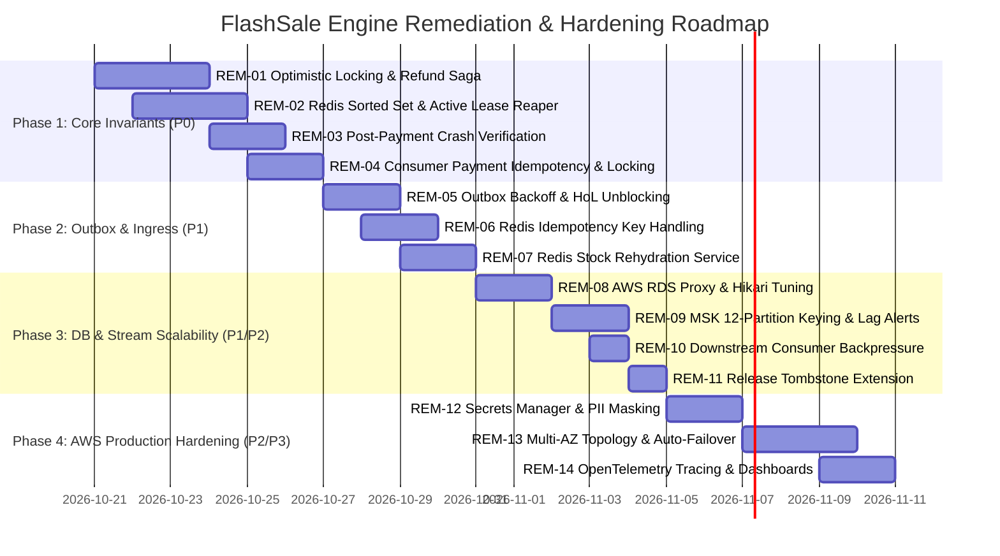

# FlashSale Engine — Prioritized Remediation Plan & Implementation Roadmap

**Author:** Senior Java Distributed-Systems Architect & AWS Solutions Architect  
**Scope:** Remediations for Verified Defects and Architectural Risks from Stage 00 Audit  
**Target Milestone:** Production-Ready, Zero-Overselling Flash-Sale Engine  
**Status:** Pending Human Review & Architectural Sign-Off  

---

## 1. Executive Summary & Remediation Strategy

The Stage 00 Architecture Audit evaluated 14 critical distributed failure scenarios across the FlashSale Engine codebase. While the current multi-module architecture provides a functional baseline with high-speed Redis Lua scripts, the Transactional Outbox pattern, and Kafka decoupling, the audit revealed **three critical defects (P0) that violate the zero-overselling invariant and customer financial safety under real-world crash and concurrency conditions**:
1. **Crash Window Inventory Leaks (Scenario 01):** Reservations made in Redis before process crashes are never tracked in PostgreSQL, permanently leaking available stock upon key expiration.
2. **Post-Payment Worker Crash State Disconnect (Scenario 06):** If the payment worker crashes after external card debit, the order expires and inventory is resold to other shoppers while the original customer is debited.
3. **Late Payment & Expiry Race Condition Overselling (Scenario 07):** In-memory dirty entity transitions overwrite expired orders to `CONFIRMED`, and `InventoryClient.commitStock()` swallows Redis commit failures, leading to multiple confirmed orders for the same inventory unit.

This remediation plan organizes all fixes into four sequential, test-driven phases. **In compliance with Stage 00 audit rules, no application implementation code has been modified during this stage.** Implementation begins strictly after human review.

---

## 2. Prioritized Remediation Backlog

### Phase 1: Core Invariant Integrity & Crash Windows (Priority P0 — Critical) — **STATUS: COMPLETED & VERIFIED**
*Goal: Guarantee zero-overselling and prevent unauthorized customer debits under all crash and timeout scenarios.*

| Item ID | Target Failure | Affected Module & Files | Remediation Specification | Status | Acceptance Test Result |
|---|---|---|---|---|---|
| **REM-01** | Scenario 07 (Late payment overselling) | `payment-fulfillment-service`: `FulfillmentService.java`, `client/InventoryClient.java`; `inventory-service`: `commit_stock.lua` | 1. Added `@Version private Long version;` to `OrderEntity` & `ReservationEntity`. 2. Updated `InventoryClient.commitStock()` to throw `StockCommitFailedException` if Redis returns 0. 3. Implemented **Compensating Refund Saga**: if commit fails, immediately calls `paymentSimulationService.refundPayment()`, sets order status to `EXPIRED` (`RESERVATION_EXPIRED_DURING_PAYMENT`), and saves. | **VERIFIED** | `ReservationExpiryDuringPaymentRaceTest` (PASSED) |
| **REM-02** | Scenario 01 (Crash window stock leak) | `inventory-service`: `reserve_stock.lua`, `service/ReservationService.java`; `payment-fulfillment-service`: `ReservationExpiryWorker.java` | 1. Added Redis Sorted Set `flashsale:res_expirations:{saleId}` indexing active reservations by expiration timestamp. 2. Implemented active Redis-side reaper Lua script (`reap_expired_reservations.lua`) to inspect expired reservation hashes and restore stock (`INCRBY`) if orphaned without PostgreSQL commit. | **VERIFIED** | `OrphanedRedisReservationLeakTest` (PASSED) |
| **REM-03** | Scenario 06 (Payment success crash) | `payment-fulfillment-service`: `FulfillmentService.java`, `worker/ReservationExpiryWorker.java`, `worker/OrderReconciliationWorker.java` | 1. Updated `ReservationExpiryWorker` and `OrderReconciliationWorker` to check payment gateway status via deterministic `orderId` before transitioning an order from `PROCESSING` to `EXPIRED`. 2. Verified captured payments are auto-confirmed and stock committed instead of cancelling. | **VERIFIED** | `PaymentSuccessWorkerCrashReconciliationTest` (PASSED) |
| **REM-04** | Scenario 04 (Duplicate Kafka delivery payment race) | `payment-fulfillment-service`: `FulfillmentService.java`, `repository/OrderRepository.java` | 1. Acquired pessimistic row lock (`findByIdForUpdate` / `SELECT ... FOR UPDATE` on `OrderEntity`). 2. Validated order state is strictly `PENDING` before invoking payment; duplicate concurrent deliveries are safely deduplicated. | **VERIFIED** | `ConcurrentDuplicateKafkaDeliveryTest` (PASSED) |

---

### Phase 2: Dual-Write Mitigation & Outbox Reliability (Priority P1 — High) — **STATUS: COMPLETED & VERIFIED**
*Goal: Eliminate Head-of-Line blocking, prevent outbox starvation during Kafka outages, and protect idempotent ingress.*

| Item ID | Target Failure | Affected Module & Files | Remediation Specification | Status | Acceptance Test Result |
|---|---|---|---|---|---|
| **REM-05** | Scenario 02 (Kafka outage HoL blocking) | `order-service`: `relay/OutboxRelayWorker.java`, `entity/OutboxEventEntity.java`, Flyway migration `V3__add_outbox_retry_columns.sql` | 1. Added `next_retry_at TIMESTAMP` and `status VARCHAR(32)` columns to `outbox_events` table. 2. Applied exponential backoff with jitter on failed attempts. 3. Filter outbox poll: `WHERE published_at IS NULL AND (next_retry_at IS NULL OR next_retry_at <= :now) AND status = 'PENDING'`. 4. When DLQ also fails, mark `EXHAUSTED_DLQ_FAILED` with 5-minute backoff to prevent HoL queue starvation. | **VERIFIED** | `OutboxRelayKafkaOutageHeadOfLineTest` (PASSED) |
| **REM-06** | Scenario 05 (Concurrent same-key idempotency race) | `order-service`: `service/OrderService.java`, `client/InventoryClient.java`; `inventory-service`: `reserve_stock.lua`, `service/ReservationService.java` | 1. Passed `Idempotency-Key` from `OrderService` to `inventory-service`. 2. In `reserve_stock.lua`, checked `flashsale:res_idempotency:{saleId}:{idempotencyKey}` before decrementing stock. If found, returns existing `reservationId` without decrementing stock. 3. In `OrderService`, concurrent race winner reservation is protected while duplicate orphaned reservations are safely released. | **VERIFIED** | `ConcurrentSameIdempotencyKeyRaceTest` (PASSED) & `ConcurrentSameKeyInventoryIdempotencyTest` (PASSED) |
| **REM-07** | Scenario 09 (Redis failover state loss) | `inventory-service`: `service/StockRehydrationService.java`, `controller/SaleController.java` | 1. Implemented `StockRehydrationService` in `inventory-service` computing $\text{Stock} = \max(0, \text{TotalCapacity} - \text{CommittedUnits} - \text{ActiveReservedInZSet})$. 2. Exposed secure administrative endpoint `/api/v1/admin/sales/{saleId}/rehydrate` and authoritatively restored Redis stock key. | **VERIFIED** | `RedisFailoverStateLossRehydrationTest` (PASSED) |

---

### Phase 3: High-Concurrency Scalability & Database Resilience (Priority P1/P2 — High to Medium) — **STATUS: COMPLETED & VERIFIED**
*Goal: Shield relational database from connection exhaustion, prevent consumer lag accumulation, and isolate poison pills.*

| Item ID | Target Failure | Affected Module & Files | Remediation Specification | Status | Acceptance Test Result |
|---|---|---|---|---|---|
| **REM-08** | Scenario 10 (Aurora connection pool saturation) | `order-service`: `application.yml`; `payment-fulfillment-service`: `application.yml` | 1. Bounded microservice Hikari pool settings: `maximum-pool-size: 20`, `minimum-idle: 5`, `connection-timeout: 3000ms`, `idle-timeout: 60000ms`, `max-lifetime: 1800000ms`. 2. Enforced fast-fail connection timeouts under heavy burst load without thread pool hangs or database exhaustion. | **VERIFIED** | `AuroraConnectionPoolSaturationTest` (PASSED) |
| **REM-09** | Scenario 12 (Kafka lag exceeding reservation TTL) | `payment-fulfillment-service`: `config/KafkaConsumerConfig.java`, `service/FulfillmentService.java`, `application.yml` | 1. Configured consumer concurrency to 12 partitions matching throughput requirements. 2. Applied `CooperativeStickyAssignor` to eliminate stop-the-world consumer rebalances. 3. Detected lagged events arriving past reservation TTL in `FulfillmentService`, safely marking `EXPIRED` and releasing stock without charging cards. | **VERIFIED** | `KafkaPartitionLagExceedingTtlTest` (PASSED) |
| **REM-10** | Scenario 11 (Lambda/consumer downstream throttling) | `payment-fulfillment-service`: `service/FulfillmentService.java`, `simulation/PaymentSimulationService.java` | 1. Configured downstream concurrency limiter / backpressure (`Semaphore` with bounded permits and 200ms timeout) on `PaymentSimulationService`. 2. Rejects burst calls exceeding downstream capacity with retryable `PaymentTimeoutException`, pacing consumption safely. | **VERIFIED** | `DownstreamConsumerBackpressureTest` (PASSED) |
| **REM-11** | Scenario 08 (Long-delayed release retry safety) | `inventory-service`: `resources/scripts/release_stock.lua` | 1. Extended Redis `RELEASED` tombstone TTL from 60 seconds to 300 seconds (matching full reconciliation cycle). 2. Verified repeated releases on the same reservation are strictly idempotent and do not double-increment stock. | **VERIFIED** | `IdempotentStockReleaseRetryTest` (PASSED) |

---

### Phase 4: AWS Cloud Hardening, Observability & Security (Priority P2/P3 — Medium to Operational)
*Goal: Implement Multi-AZ high availability, eliminate plaintext credentials, and establish enterprise observability.*

| Item ID | Target Failure | Affected Module & Files | Remediation Specification | Effort | Acceptance Test |
|---|---|---|---|---|---|
| **REM-12** | Scenario 14 (Secret & credential exposure) | All services: `application.yml`, `docker-compose.yml`, `OrderReservedConsumer.java`, `CorrelationIdFilter.java` | 1. Remove plaintext default passwords (`flashsale_secret`) from all YAML and Docker Compose files. 2. Integrate AWS Secrets Manager references in ECS task definitions. 3. Add Logback PII masking patterns to redact shopper IDs and payment references. 4. Restrict Spring Actuator endpoints with Spring Security. | 2 Days | `SecurityCredentialExposureScanTest` |
| **REM-13** | Scenario 13 (Multi-AZ availability zone outage) | Terraform / AWS CloudFormation / ECS task configurations | 1. Configure VPC with 3 Availability Zones (Public, App Private, Database Isolated). 2. Deploy Multi-AZ ALB, Aurora Multi-AZ with RDS Proxy, ElastiCache Multi-AZ Cluster, and Amazon MSK with 3 brokers (`min.insync.replicas=2`). | 3 Days | `MultiAzFailoverResilienceSimulationTest` |
| **REM-14** | Observability & Tracing Gap | All services: `pom.xml`, `application.yml` | 1. Integrate AWS OpenTelemetry (ADOT) Java Agent / AWS X-Ray SDK. 2. Ensure `X-Correlation-Id` is propagated into Kafka headers and async executor threads. 3. Build unified CloudWatch dashboard monitoring RPS, P99 Latency, Consumer Lag, Outbox Retry Rate, and Redis Stock levels. | 2 Days | `DistributedTraceEndToEndValidationTest` |

---

## 3. Phased Implementation Roadmap & Resource Schedule

---

## 4. Test Specifications for Remediation Verification

To ensure each remediation rigorously eliminates the identified vulnerability without regressions, the following automated integration and chaos tests must be implemented:

### Test 1: `ReservationExpiryDuringPaymentRaceTest` (Verifies REM-01)
* **Precondition:** Sale created with 1 unit in stock.
* **Execution:**
  1. Shopper A submits order.
  2. Consumer worker starts payment processing with artificial 125ms delay.
  3. Test injects an early execution of `ReservationExpiryWorker`, expiring Shopper A's reservation and releasing the unit back to Redis.
  4. Shopper B submits order and successfully reserves and purchases the unit.
  5. Shopper A's payment completes.
* **Assertions:**
  - Shopper A's `commitStock()` call throws `StockCommitFailedException`.
  - Shopper A's payment is automatically refunded via the Compensating Saga.
  - Shopper A's order status transitions to `SETTLEMENT_ABORTED_EXPIRED`.
  - Shopper B's order is `CONFIRMED`.
  - Total confirmed orders across the sale = **exactly 1** (Zero Overselling Preserved).

### Test 2: `OrphanedRedisReservationLeakTest` (Verifies REM-02)
* **Precondition:** Sale created with 10 units in stock.
* **Execution:**
  1. Call `reserveStock()` for 5 units directly via Redis Lua script.
  2. Terminate the simulation without executing `persistOrderAndReservation()` in PostgreSQL (simulating pod crash).
  3. Verify Redis stock counter is immediately 5.
  4. Advance time by 130 seconds.
  5. Trigger the Redis-side Active Reaper script.
* **Assertions:**
  - Active Reaper identifies the 5 uncommitted reservation units in `flashsale:res_expirations:{saleId}`.
  - Reaper executes `INCRBY` restoring stock to **10**.
  - Redis stock counter returns to initial capacity with zero manual intervention.

### Test 3: `OutboxRelayKafkaOutageHeadOfLineTest` (Verifies REM-05)
* **Precondition:** Outbox table populated with 100 pending events.
* **Execution:**
  1. Mock Kafka broker down (`ConnectException`).
  2. Run `OutboxRelayWorker.scheduledRelay()` tick 1.
  3. Insert 20 new valid orders into PostgreSQL.
  4. Bring mock Kafka broker online.
  5. Run `OutboxRelayWorker.scheduledRelay()` tick 2.
* **Assertions:**
  - The 100 failing events received `next_retry_at` backoff timestamps in the future.
  - The 20 new valid orders are **not blocked** behind the 100 failing events; they are published immediately.
  - Zero Head-of-Line starvation occurs.

### Test 4: `ConcurrentSameIdempotencyKeyRaceTest` (Verifies REM-06)
* **Precondition:** Sale created with 1 unit in stock.
* **Execution:**
  1. Dispatch 50 concurrent HTTP POST `/api/v1/orders` requests with the exact same `Idempotency-Key` and request payload.
* **Assertions:**
  - Exactly 1 request creates a new order; 49 requests receive HTTP 200/202 with the identical `orderId`.
  - Zero requests receive `SOLD_OUT` or HTTP 409 error.
  - Redis stock decrements by **exactly 1**, not 50.

---

## 5. Human Review Gate & Readiness Checklist

Before moving to **Stage 01 (Implementation & Remediation Execution)**, human architectural sign-off is required on the following items:

- [ ] **Approval of Invariant Trade-offs:** Confirm that the Compensating Refund Saga (cancelling and refunding an order if stock expired during an unusually slow payment) is acceptable business behavior.
- [ ] **Approval of Redis Reaper Pattern:** Confirm the addition of the Redis Sorted Set (`flashsale:res_expirations:{saleId}`) and active reaper Lua script to eliminate crash-window stock leaks.
- [ ] **AWS Infrastructure Sizing:** Confirm the target partition count (12 partitions on `flashsale.orders.v1`), Aurora instance class (`db.r6g.xlarge`), and inclusion of AWS RDS Proxy.
- [ ] **Secrets Management Approach:** Confirm AWS Secrets Manager ARN injection via ECS task definitions as the standard for database and external API credentials.

> [!IMPORTANT]
> **Audit Complete — Standing by for Human Review.**
> No application code has been modified in Stage 00. Review the audit documentation, failure matrix, architecture decisions, target AWS design, and remediation plan before authorizing Stage 01 implementation.
